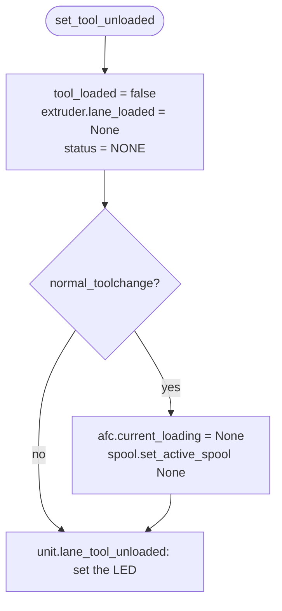

# `set_tool_unloaded`

**Class:** `AFCLane`  
**File:** `extras/AFC_lane.py`

Marks a lane as no longer in the toolhead and clears the extruder's lane.

## Flow

## Where it lives in code

| Step | Code |
| --- | --- |
| Method | `AFCLane.set_tool_unloaded` in `extras/AFC_lane.py` |
| Extruder link | `AFCExtruder.lane_loaded` in `extras/AFC_extruder.py` |
| Active spool | `AFCSpool.set_active_spool` |
| LED | `afcUnit.lane_tool_unloaded` in `extras/AFC_unit.py` |
| Called from | [`afc.unload_sequence`](../AFC/unload_sequence.md), after filament is behind the extruder, and `afcFunction.unset_lane_loaded` for the manual `UNSET_LANE_LOADED` command |

## Notes

- The lane stays loaded in the unit. Only [`AFCLane.set_unloaded`](set_unloaded.md) clears that.

## Related

- [`AFCLane.set_tool_loaded`](set_tool_loaded.md)
- [`afc.unload_sequence`](../AFC/unload_sequence.md)
