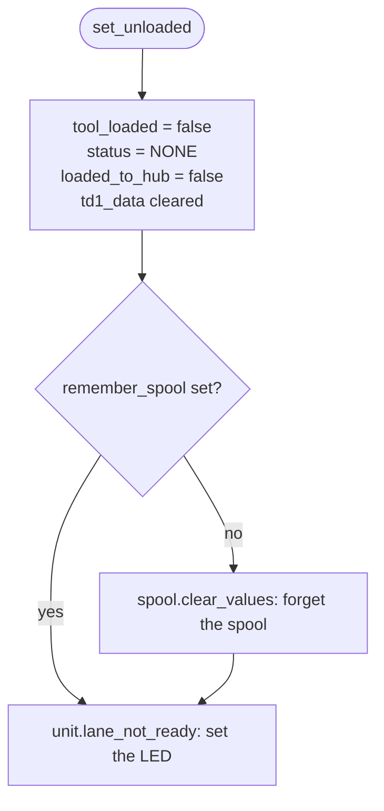

# `set_unloaded`

**Class:** `AFCLane`  
**File:** `extras/AFC_lane.py`

Marks a lane as empty: the spool has been removed or ejected.

## Flow

## Where it lives in code

| Step | Code |
| --- | --- |
| Method | `AFCLane.set_unloaded` in `extras/AFC_lane.py` |
| Spool values | `AFCSpool.clear_values` in `extras/AFC_spool.py` |
| LED | `afcUnit.lane_not_ready` in `extras/AFC_unit.py` |
| Setting | `remember_spool`, per unit or per lane, keeps color and material after a removal |

## Notes

- Called when a prep sensor goes low outside a print, or a load switch is released. It does not touch `extruder_obj.lane_loaded`, which is [`AFCLane.set_tool_unloaded`](set_tool_unloaded.md)'s job.

## Related

- [`AFCLane.set_loaded`](set_loaded.md)
- [`AFCLane.set_tool_unloaded`](set_tool_unloaded.md)
