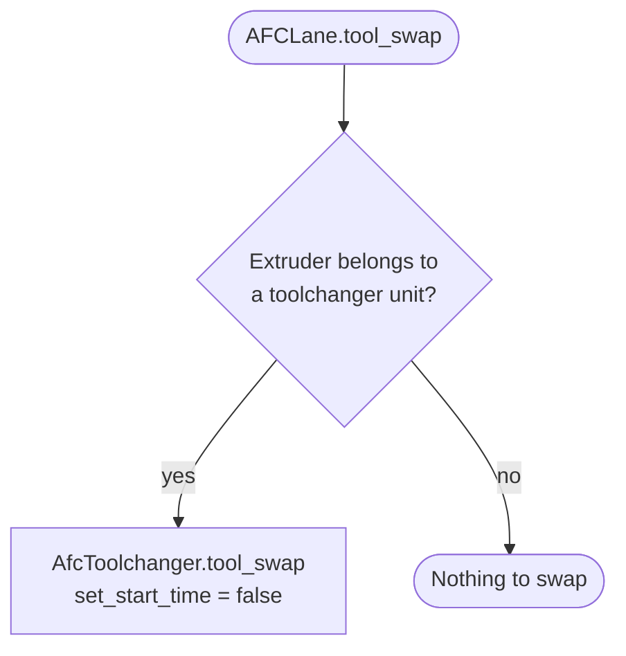

# `tool_swap`

**Class:** `AFCLane`  
**File:** `extras/AFC_lane.py`

Thin wrapper that hands a toolhead swap to the toolchanger unit that owns the lane's extruder.

## Flow

## Where it lives in code

| Step | Code |
| --- | --- |
| Method | `AFCLane.tool_swap` in `extras/AFC_lane.py` |
| Toolchanger | `AFCExtruder.tc_unit_obj`, then [`AfcToolchanger.tool_swap`](../AFC_Toolchanger/tool_swap.md) |
| Callers | [`afc.TOOL_LOAD`](../AFC/TOOL_LOAD.md) and [`afc.TOOL_UNLOAD`](../AFC/TOOL_UNLOAD.md) |

## Notes

- `set_start_time=False` keeps the timing started by [`afc.CHANGE_TOOL`](../AFC/CHANGE_TOOL.md), so the swap counts towards the total change time.

## Related

- [`AfcToolchanger.tool_swap`](../AFC_Toolchanger/tool_swap.md)
