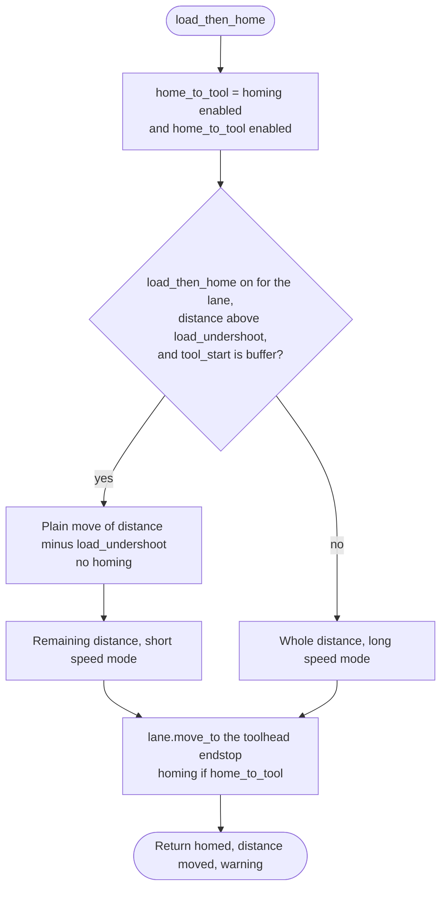

# `load_then_home`

**Class:** `afcUnit`  
**File:** `extras/AFC_unit.py`

Moves filament from the hub to the toolhead sensor, either with a long homing move or with a plain move followed by a short homing move.

## Flow

## Where it lives in code

| Step | Code |
| --- | --- |
| Method | `afcUnit.load_then_home` in `extras/AFC_unit.py` |
| Move | [`AFCLane.move_to`](../AFC_lane/move_to.md) |
| Settings | `load_then_home`, `load_undershoot`, `AFC.cfg` `homing_enabled` and `home_to_tool` |
| Buffer check | `AFCExtruder.tool_start`, equal to `buffer` when a buffer is used as the toolhead sensor |
| Callers | [`afc.load_sequence`](../AFC/load_sequence.md) |

## Notes

- The plain move first is for buffers: it brings filament close, and the homing move that follows is short enough to stop on the buffer without ramming it.

## Related

- [`afcUnit.move_to_hub`](move_to_hub.md)
- [`afc.load_sequence`](../AFC/load_sequence.md)
