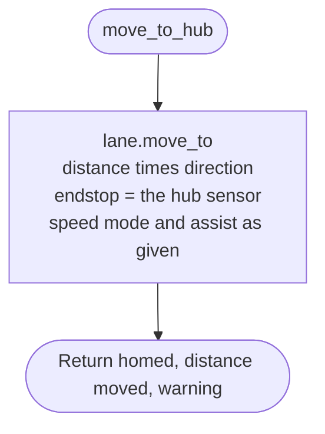

# `move_to_hub`

**Class:** `afcUnit`  
**File:** `extras/AFC_unit.py`

Moves a lane toward or away from the hub sensor. Units can override it when they move filament differently.

## Flow

## Where it lives in code

| Step | Code |
| --- | --- |
| Method | `afcUnit.move_to_hub` in `extras/AFC_unit.py` |
| Move | [`AFCLane.move_to`](../AFC_lane/move_to.md) |
| Endstop | `AFCLane.hub_endstop_name` |
| Direction | `MoveDirection.POS` toward the hub, `NEG` away, in `extras/AFC_lane.py` |
| Callers | [`afc.load_sequence`](../AFC/load_sequence.md) and [`afc.unload_sequence`](../AFC/unload_sequence.md) |
| Overrides | `move_to_hub` on a unit class that needs different behavior, for example the toolchanger unit, which returns at once because it has no hub |

## Notes

- It is a one-line wrapper on purpose. Units override it, and the load and unload sequences stay the same.

## Related

- [`afcUnit.load_then_home`](load_then_home.md)
- [`AFCLane.move_to`](../AFC_lane/move_to.md)
