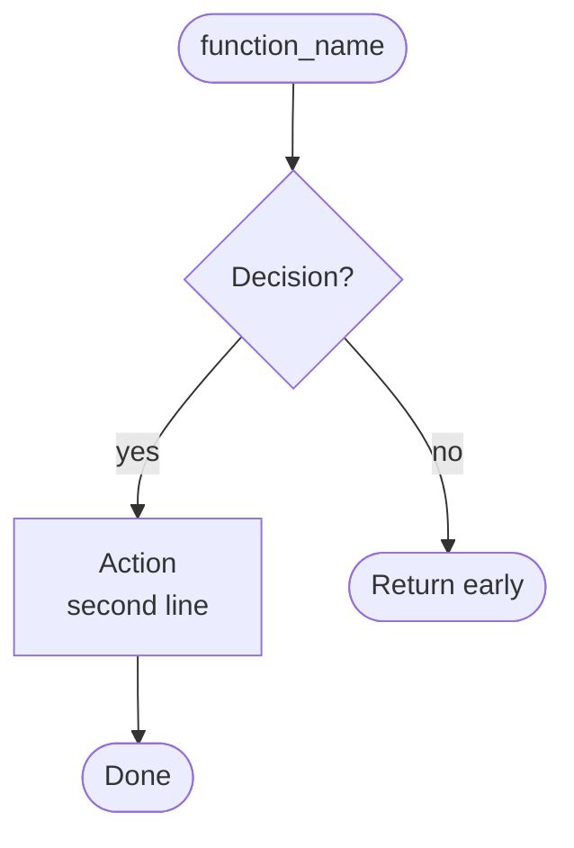

# `function_name`

**Class:** `ClassName`  
**File:** `extras/module_file.py`

One or two sentences on what this function is for. Link other functions like this: [`ClassName.other_function`](other_function.md).

## Flow

## Where it lives in code

| Step | Code |
| --- | --- |
| Method | `ClassName.function_name` in `extras/module_file.py` |
| First action | `ClassName.helper`, or a link such as [`afcUnit.move_to_hub`](../AFC_unit/move_to_hub.md) |
| A setting it reads | `ClassName.some_attribute`, set from `some_option` in the config |

## Notes

- Behavior that is easy to miss: a limit, an ordering that matters, a side effect.
- Why a branch exists, when the reason is not obvious from the diagram.

## Related

- [`ClassName.other_function`](other_function.md)
